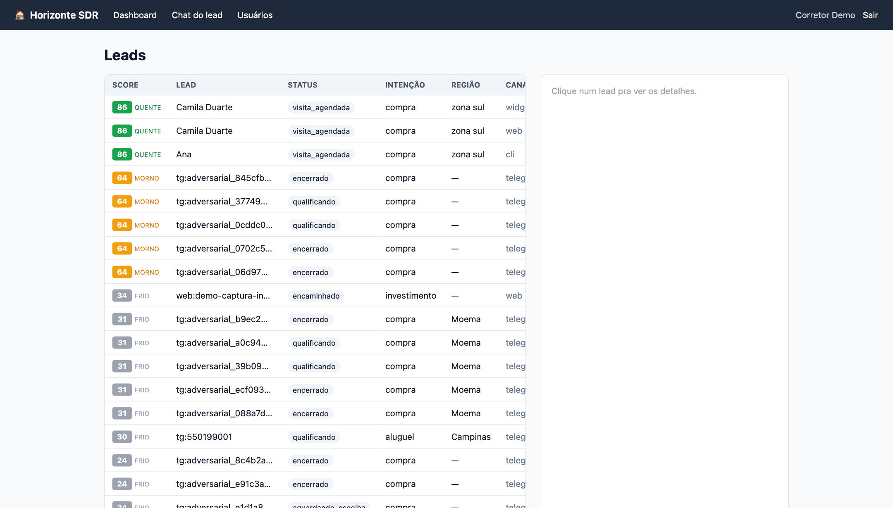
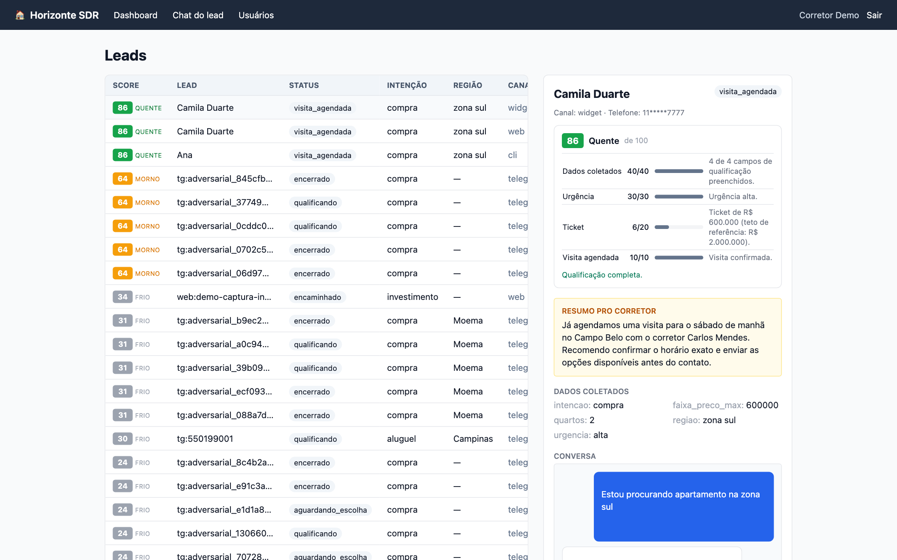
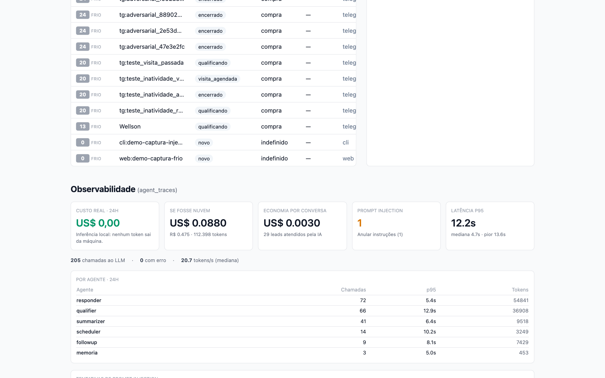

# Agente SDR Imobiliário — Bia

POC de um agente de IA que atende, qualifica e agenda visitas com leads de uma imobiliária. Projeto do **FIAP Tech Challenge Fase 5**.

A Bia atende por Telegram (texto e áudio), chat web, widget embutido no site da imobiliária ou CLI — os quatro canais batem no mesmo orquestrador. Entende se o lead quer comprar, alugar ou investir, qualifica com uma pergunta por mensagem, mostra imóveis reais do banco, agenda a visita com o corretor certo e volta a procurar quem some no meio do caminho. O corretor acompanha num painel com score explicado, resumo e observabilidade.

> **Estado da entrega:** funcional, rodando local com Docker Compose e Ollama nativo. **271 testes passando.** O modelo é local (`qwen3.5:9b`, por Metal) — não há WhatsApp nem deploy publicado, e a transcrição de áudio só funciona em Apple Silicon. Para avaliar em Windows ou Linux, veja o [modo demonstração](#rodar-em-1-minuto-em-qualquer-máquina-modo-demonstração) logo abaixo.

## Guia rápido para a avaliação

| Pergunta | Onde está a resposta |
|---|---|
| Quais requisitos do desafio foram atendidos, e como? | [docs/VALIDACAO_REQUISITOS.md](docs/VALIDACAO_REQUISITOS.md) — requisito → código → teste que comprova |
| Como instalo? | [INSTALL.md](INSTALL.md) — passo a passo por tipo de máquina, portas e problemas comuns |
| Como rodo isso sem um Mac com GPU? | [Modo demonstração](#rodar-em-1-minuto-em-qualquer-máquina-modo-demonstração), aqui embaixo |
| Qual é a arquitetura? | [ARQUITETURA.md](ARQUITETURA.md) — camadas, grafo e fluxos · [docs/SOLID.md](docs/SOLID.md) — princípios mapeados a arquivo e função |
| Que IA é usada, e por quê? | [IA.md](IA.md) — inclusive os achados que mudaram decisões |
| Como fica na tela? | [Em imagens](#em-imagens) |
| Quais diferenciais foram implementados? | [Diferenciais, na matriz de requisitos](docs/VALIDACAO_REQUISITOS.md#diferenciais) |
| Como a qualidade é verificada? | [Testes](#testes) — 271, incluindo adversariais contra alucinação |
| Por que as decisões foram essas? | [PLANO.md](PLANO.md) — diário de bordo com os ~15 bugs reais achados e corrigidos |

---

## O problema

Imobiliária perde lead por motivo banal, e cada lead custa caro:

- **Tempo de resposta.** Quem manda mensagem às 22h de sábado fala com o concorrente antes de falar com você.
- **Falta de follow-up.** Quem não respondeu à primeira mensagem é abandonado.
- **Falta de priorização.** O corretor trata igual quem quer mudar em 30 dias e quem está só olhando.
- **Sobrecarga.** O corretor faz triagem em vez de vender.

## A solução, e o que a diferencia

Um SDR digital que atende 24h em conversa natural — e que, neste projeto, roda **inteiramente na máquina da imobiliária**:

- **Custo de inferência zero e dado que não viaja.** Modelo local, banco local. Nenhum token do seu cliente sai da máquina, e não há fatura de API. O painel mostra `US$ 0,00` ao lado do que a mesma conversa teria custado numa API paga.
- **Fato crítico nunca escrito pelo LLM.** Preço, endereço, data e corretor são montados em código a partir do banco. Testado adversarialmente: [`test_adversarial.py`](tests/test_adversarial.py) não verifica se a resposta é bonita, verifica se ela **mente**.
- **Score explicável.** O painel abre a conta em vez de mostrar só o número, e diz o que falta perguntar.
- **Fluxo decidido em código, texto decidido pelo LLM.** O roteador não chama o modelo — ele devolve um rótulo, e só depois o LLM escreve a frase daquele rótulo.

## Em imagens

<!-- Capturas da aplicação real. O que cada uma mostra, e que mudança obriga a
     refazê-la, está em docs/imagens/README.md; scripts/screenshots/ refaz todas
     com o mesmo enquadramento. -->

| Dashboard do corretor | Detalhe do lead, com o score aberto |
|---|---|
|  |  |
| **Observabilidade: custo, p95 e injeções** | **Chat do lead, com galeria de imóveis** |
|  |  |

Mais telas: [a Bia embutida no site de uma imobiliária](docs/imagens/widget.png) ·
[tentativa de prompt injection, marcada e classificada](docs/imagens/injection.png).

---

Documentos: [ARQUITETURA.md](ARQUITETURA.md) · [docs/VALIDACAO_REQUISITOS.md](docs/VALIDACAO_REQUISITOS.md) · [docs/SOLID.md](docs/SOLID.md) · [IA.md](IA.md) · [PITCH.md](PITCH.md) · [PLANO.md](PLANO.md) · [docs/ENUNCIADO.md](docs/ENUNCIADO.md) (enunciado literal do desafio).

## Rodar em 1 minuto, em qualquer máquina (modo demonstração)

O projeto roda com um modelo de 9B local, por Metal — é a decisão central da arquitetura. Mas isso tem um custo que não é técnico: quem for **avaliar** precisaria de um Mac com Apple Silicon, 9 GB de modelo em disco, Docker e Postgres.

Para isso existe o modo demonstração. Troca o Ollama por um provedor de regras ([`app/core/llm_demo.py`](app/core/llm_demo.py)) e roda o fluxo inteiro — qualificação, busca no banco, agendamento, follow-up, resumo — em Windows, Linux ou Mac sem GPU:

```bash
uv venv --python 3.12 && source .venv/bin/activate && uv pip install -e .
docker compose up -d && python -m scripts.preparar_banco
LLM_DEMO=true python -m app.channels.cli
```

```
> Estou procurando apartamento na zona sul
< Perfeito, anotei. Qual faixa de preço você tem em mente?
> Até 600 mil
< Ótimo. De quantos quartos você precisa?
> 2 quartos
< Entendi. Você tem pressa pra fechar, ou pode esperar um pouco?
> Tenho pressa, quero mudar logo
< Encontrei essas opções pra você:
  1. Apartamento 2 quarto(s) — Campo Belo · R$ 311.000 · 45m²
> Quero o 1 … Sábado de manhã … Meu nome é Wellson, telefone 11 98888-7777
< Show, Wellson! Marquei sua visita ao Apartamento Campo Belo com Fernanda Souza,
  para sábado de manhã — 17/10.
```

Os imóveis, o corretor, a data e o preço são reais, vindos do Postgres: só o **texto** sai de regra em vez de modelo. As respostas são bem piores que as do Ollama, e é esse o ponto — demonstra **fluxo**, não qualidade de redação. Em `agent_traces` o modelo aparece como `demo-rules`, sem contagem de tokens, para que o painel de observabilidade nunca passe número inventado por medição.

Os testes de integração continuam exigindo o Ollama real: os bugs que mais custaram neste projeto foram de formato (`anyOf` devolvendo `null` em silêncio, chave `"intenção"` com acento, `think: false` faltando) e nenhum deles apareceria contra um provedor de regra.

## Como rodar

Pré-requisitos: macOS com Apple Silicon (Metal é usado pelo Ollama e pelo Whisper), Docker, Python 3.12, [`uv`](https://github.com/astral-sh/uv), [Ollama](https://ollama.com) instalado nativamente (**nunca em container** — sem Metal, a inferência cai pra velocidade de CPU).

```bash
# 1. modelos do Ollama (se ainda não estiverem em disco)
ollama pull qwen3.5:9b
ollama pull nomic-embed-text
ollama serve &

# 2. banco (Postgres 16 + pgvector)
docker compose up -d

# 3. dependências
uv venv --python 3.12
source .venv/bin/activate
uv pip install -e .

# 4. configuração
cp .env.example .env
# editar TELEGRAM_BOT_TOKEN (token do BotFather; vazio = Telegram desligado,
# web chat e CLI seguem funcionando)

# 5. schema + seed de imóveis
python -m scripts.preparar_banco   # schema + seed, idempotente

# 6. subir tudo (Telegram + dashboard + chat web + CRM + follow-up, um processo só)
uvicorn app.web.api:app --host 0.0.0.0 --port 8000
```

Dashboard: `http://localhost:8000/dashboard`. Chat web do lead: `http://localhost:8000/chat`. CLI alternativa (sem Telegram): `python -m app.channels.cli`.

No primeiro acesso ao dashboard, o app manda pra `/registro`: essa primeira conta vira administrador e o cadastro aberto fecha em seguida. Os demais usuários entram por convite, em `/dashboard/usuarios`.

### Rodando o app em container (alternativa)

```bash
docker compose --profile app up -d --build
```

Sobe Postgres e app juntos; o schema e o seed rodam sozinhos no entrypoint (idempotentes — [scripts/preparar_banco.py](scripts/preparar_banco.py) só semeia se `imoveis` estiver vazia, porque o seed começa com `TRUNCATE ... CASCADE` e levaria as visitas junto).

Duas coisas que **não** mudam de lugar:

- **O Ollama continua nativo no host.** Dentro de container no macOS não existe Metal e a inferência cai pra velocidade de CPU. O container chega nele por `host.docker.internal:11434`, via `extra_hosts: host-gateway`.
- **STT fica desligado no container.** `mlx-whisper` depende do MLX (Apple Silicon + Metal) e não instala em Linux. Transcrição de áudio só rodando nativo, com `./run.sh`.

`docker compose up -d` sem o `--profile app` continua subindo só o banco — o fluxo do `run.sh`.

> ⚠️ **Um bot, uma instância.** O Telegram só aceita um `getUpdates` por token: rodar `./run.sh` e o container ao mesmo tempo faz os dois brigarem (`Conflict: terminated by other getUpdates request`). Escolha um.

### Voz: a Bia ouve e responde falando (opcional)

**Transcrição** (entrada) e **síntese** (saída) são as duas metades do Voice AI, e as duas rodam locais — nenhuma API paga, nenhum áudio do cliente saindo da máquina.

```bash
# no .env
STT_ENABLED=true     # transcreve o áudio do cliente (Apple Silicon)
TTS_ENABLED=true     # responde em áudio
```

Por padrão a Bia só **responde em áudio para quem mandou áudio** — responder na mesma modalidade é o que um humano faz, e mandar voz para quem digitou é intrusivo. `TTS_SEMPRE=true` força o contrário. O texto vai sempre junto: voz é complemento, não substituição, porque quem está no metrô sem fone precisa poder ler.

O backend é escolhido pelo que existe na máquina ([`core/tts.py`](app/core/tts.py)):

| Onde | Backend | Instalação |
|---|---|---|
| macOS | `say`, voz pt-BR nativa | nenhuma |
| Linux / container | `piper`, rede neural local | o Dockerfile já faz |

Aqui a assimetria com o STT se inverte: `mlx-whisper` é Apple Silicon e não entra no container, mas o `piper` entra — então **o container fala, mesmo sem ouvir**.

### Transcrição de áudio (opcional)

```bash
uv pip install -e ".[stt]"
```

No `.env`: `STT_ENABLED=true`. Se o download automático do modelo via HuggingFace Hub travar (aconteceu em teste real, ver [IA.md](IA.md)), rode `scripts/baixar_modelo_stt.sh` e aponte `STT_MODEL_PATH` para o diretório que ele baixa.

### Testes

```bash
uv pip install -e ".[dev]"
pytest
```

Boa parte da suíte é de integração real — fala com o Postgres e com o Ollama, sem mock. É proposital: mockar o LLM esconderia justamente os bugs de formato de schema que custaram caro (ver [IA.md](IA.md)). Mas nada disso **falha** por falta de infra: os testes que dependem de serviço pulam com a razão e o comando na mensagem ([tests/conftest.py](tests/conftest.py)).

```
# sem Docker e sem Ollama
142 passed, 64 skipped in 3.23s
SKIPPED tests/test_qualifier.py:17: precisa do Ollama nativo (ollama serve && ollama pull qwen3.5:9b)
SKIPPED tests/test_inatividade.py:25: precisa do Postgres (docker compose up -d)

# só com o Postgres, antes do seed
199 passed, 7 skipped in 74s

# tudo no ar
206 passed
```

## Como usar

**Telegram**: conversa normal, texto ou áudio. Ex.: *"Estou procurando apartamento na zona sul"* → o agente pergunta faixa de preço, quartos, região, urgência, e no fim apresenta imóveis reais do banco com opção de agendar visita. *"Quero investir em imóveis para renda"* leva pro fluxo de investimento (perfil, ticket, expectativa de retorno) e termina em encaminhamento a um especialista.

**Dashboard** (`/dashboard`): lista de leads ordenada por score, com selo **quente/morno/frio**, card de detalhe (slots coletados, resumo pro corretor, histórico de mensagens) e aba de observabilidade.

**Score explicável.** O número nunca é pedido ao LLM — a fórmula é determinística, e o painel mostra a conta aberta em vez de só o total:

```
86  quente  de 100
Dados coletados   40/40   4 de 4 campos de qualificação preenchidos.
Urgência          30/30   Urgência alta.
Ticket             6/20   Ticket de R$ 600.000 (teto de referência: R$ 2.000.000).
Visita agendada   10/10   Visita confirmada.
Qualificação completa.
```

A explicação **é** o cálculo, não uma narração dele: o total é a soma das parcelas, e um teste trava isso. Quando falta dado, o painel diz o que perguntar ("Falta perguntar: orçamento, urgência"). Uma regra de negócio fica acima do número: **sem orçamento informado, a prioridade não passa de morno** — um lead pode somar 70+ só com urgência e campos preenchidos sem nunca ter dito quanto pode pagar, e mandar o corretor ligar primeiro pra esse desperdiça a ligação.

**Observabilidade** (`/dashboard/traces`): além da tabela de chamadas, indicadores agregados da janela — latência p50/p95/pior, tokens/s mediano, taxa de erro e quebra por agente (qual agente custa caro). E o número que resume a arquitetura: **custo real US$ 0,00** ao lado do contrafactual *"se fosse nuvem"*, calculado aplicando preço de tabela aos tokens realmente medidos. Os preços são de referência e ficam no `.env` — não há consulta a API de preço nem de câmbio.

**CRM** (`POST /crm/leads`, `GET /crm/leads.csv`): entrada simulada de lead vindo de fora do Telegram e exportação da base de leads.

**Widget** — a Bia entra no site de qualquer imobiliária com uma linha, antes de `</body>`:

```html
<script src="http://localhost:8000/widget.js" data-brand="Imobiliária Exemplo" defer></script>
```

Uma bolha flutuante abre o chat num iframe (tela cheia no celular). O CSS fica isolado em Shadow DOM, então o tema do site não deforma o widget nem o contrário, e o iframe só carrega no primeiro clique — quem nunca abre o chat não paga o custo. A sessão vive no `localStorage` do site que hospeda, não em cookie: dentro de um iframe de outra origem o cookie seria third-party, e Safari e Firefox bloqueiam. O lead que chega por aí entra com canal `widget`, separado de `telegram` e `web` no dashboard. `data-position="left"` troca o lado; `Bia.abrir()` abre o chat a partir de um botão do próprio site.

Quem pode embutir é controlado por `WIDGET_DOMINIOS` no `.env`, que vira `frame-ancestors` no CSP — quem recusa é o navegador, não o nosso código.

## Arquitetura em uma frase

Um processo FastAPI único hospeda o Telegram (long polling), o chat web, o dashboard, o CRM e o scheduler de follow-up. Todos os canais chamam o mesmo orquestrador (`core/graph.py`, um `StateGraph` do LangGraph), que por sua vez chama cinco agentes lógicos — não processos, funções puras — todos batendo no mesmo modelo Ollama já residente em memória. Detalhes completos em [ARQUITETURA.md](ARQUITETURA.md).

```
app/
  agents/   router.py  qualifier.py  search.py  scheduler_agent.py  summarizer.py
  core/     graph.py  turno.py  llm.py  prompts.py  memory.py  followup.py
            scoring.py  security.py  traces.py  stt.py  config.py
  channels/ telegram.py  web (via app/web/api.py)  cli.py
  web/      api.py  templates/  (dashboard + chat + CRM, tudo HTMX)
  db/       schema.sql  repo.py  seed.py
scripts/    buscar.py  baixar_modelo_stt.sh
```

## O agente nunca repete a mesma coisa

`decidir_proximo` é função pura dos slots. Cliente que não responde o que foi perguntado não muda slot nenhum — a decisão não muda, e a mesma frase sai de novo. Era o caso em **6 de 6** cenários de cliente pouco cooperativo, medido por uma sonda que dirige conversas com respostas inúteis ("sim", "esse", "sei lá") e conta respostas consecutivas idênticas.

Não era um bug: era a ausência de um mecanismo. O agente não tinha noção de insistência.

Duas metades, as duas necessárias:

1. **`leads.acao_repeticoes`** conta quantas vezes **seguidas** o roteador decidiu a mesma coisa (decisão diferente zera).
2. **`leads.campos_dispensados`** tira a pergunta do roteiro na 3ª vez.

Só a primeira trocava um laço por outro: a pergunta parava, mas o campo continuava faltando e a mesma escalada disparava para sempre.

Na 3ª repetição, cada família de impasse tem uma saída — e nenhuma delas é perguntar de novo:

| Impasse | Saída |
|---|---|
| Região não sai | mostra **onde** existe imóvel |
| Orçamento não sai | mostra a faixa real da base e segue sem o campo |
| Quartos, urgência, perfil | segue o roteiro com o que já se sabe |
| Busca sempre vazia | afrouxa o filtro em ordem (preço → região → quartos) e **diz o que afrouxou** |
| Escolha da visita não resolve | reapresenta a lista **com os códigos** |
| Intenção nunca sai | passa para um corretor humano |

Hoje: **0 de 6**. A sonda virou [`tests/test_sem_loop.py`](tests/test_sem_loop.py), que roda os 6 cenários contra o Ollama real.

## Código do imóvel

Cada imóvel tem um código público e estável — `CAM-0006`, `SAN-0002` — formado por 3 letras do bairro mais uma sequência. Ele aparece no card, na legenda da foto e na confirmação da visita, e o cliente pode agendar citando ele: *"quero ver o SAN-0002"*.

Não é enfeite. O número do card (1, 2, 3) é **posicional**: só faz sentido dentro da última lista apresentada. Se o cliente voltar amanhã, depois de outra busca, "quero o 2" aponta para outro imóvel. O código não muda.

A resolução tenta, nesta ordem: **código → número → texto livre** (casar bairro). O código vem primeiro por ser o único identificador não ambíguo. É reconhecido como o cliente digitar — `MOE-0001`, `moe 0001`, `CAM0006` — e por regex, não por LLM: formato fixo não se pede para o modelo classificar.

## Fotos dos imóveis

Ficam em `app/web/static/imoveis/`, **versionadas no repositório**, e são servidas pela própria aplicação. O Telegram envia um álbum por imóvel (`send_media_group`, legenda no primeiro, numeração igual à dos cards); o chat web e o widget renderizam a mesma galeria em ``.

Antes as URLs apontavam para o `loremflickr.com` em tempo de execução. O serviço passou a responder **401** e, sem nenhuma linha do nosso código mudar, o Telegram parou de enviar foto (o álbum é pulado em silêncio quando o download falha) e o chat web passou a exibir imagem quebrada. Dependência de terceiro em tempo de execução, numa demonstração ao vivo, é risco sem contrapartida — agora não há nenhuma.

As fotos, os textos e os valores são do **catálogo real de uma imobiliária parceira** (266 imóveis, 731 fotos), usado com a autorização dela. Não há imóvel nem foto sintéticos: todo imóvel tem foto do próprio anúncio. A marca d'água da origem está desfocada (`scripts/borrar_marca.py`) e imagens de terceiros, como capturas do Google Street View, foram removidas (`scripts/achar_terceiros.py`). O catálogo é atualizado com `./atualizar_catalogo.sh`.

## Stack

Postgres 16 + pgvector · Ollama nativo (`qwen3.5:9b`, `nomic-embed-text`) · LangGraph (orquestração) · FastAPI + Jinja2 + HTMX (dashboard e chat, zero build step) · `python-telegram-bot` (long polling) · APScheduler (follow-up) · `mlx-whisper` (STT local via Metal, opcional).

## Escalabilidade

- **Aplicação stateless.** Todo estado mora no Postgres — N réplicas do FastAPI atrás de um balanceador não exigem mudança de código.
- **O LLM já está atrás de HTTP.** Trocar `OLLAMA_HOST` por um cluster com GPU é variável de ambiente, nenhuma linha de código muda.
- **O gargalo é medido, não estimado.** `agent_traces` grava latência e tokens/s reais de cada chamada — decisão de escalar (ou não) parte de número real.
- **O único componente single-node é o scheduler de follow-up** (APScheduler in-process). `follow_up_jobs` já é tabela; virar fila distribuída é um `SELECT ... FOR UPDATE SKIP LOCKED`, sem trocar de tecnologia.
- **Busca vetorial:** scan sequencial é a escolha certa com 200 imóveis; índice HNSW entra a partir de ~10 mil registros, sem mudar a query.

## Segurança

- **Painel fechado.** O dashboard, o detalhe do lead, a aba de traces e o CRM exigem login; o chat do lead e o `/health` seguem públicos (quem é atendido não tem conta). Senhas no Postgres como hash **argon2id** (`core/auth.py`), sal por hash, rehash silencioso quando os parâmetros sobem. Sessão é server-side (tabela `sessoes`, só o SHA-256 do token), não JWT: desativar um usuário corta o acesso na hora. Cookie `HttpOnly` + `SameSite=Lax`.
- **Primeiro acesso:** com o banco vazio, `/registro` abre e o primeiro cadastro vira administrador — e a rota fecha sozinha. Dali em diante, só entra quem o admin convidar em `/dashboard/usuarios`, por link de uso único com prazo (`CONVITE_HORAS`, 72 h por padrão). Não há SMTP nesta POC: o link aparece na tela e o admin entrega por fora.
- Telefone do lead nunca persiste cru — `core/security.py::mascarar_telefone` guarda só DDD + 4 últimos dígitos.
- Input do lead nunca é concatenado no system prompt (mitigação de prompt injection): sempre entra como mensagem `user`.
- **Prompt injection, medido.** A mitigação acima é estrutural — o texto do lead não tem caminho até o system prompt, e preço/endereço/data/corretor são montados em código a partir do banco, nunca escritos pelo LLM. O que faltava era prova: `core/injecao.py` detecta e classifica a tentativa em 4 tipos (anular instrução, vazar prompt, trocar persona, extrair dados), marca na mensagem (`mensagens.suspeita_injecao`) e mostra no painel com o texto cru ao lado. **Marca, não bloqueia** — a mitigação já é estrutural, e recusar um cliente real por falso positivo custa mais caro que registrar uma tentativa que não era nada. Metade dos testes do módulo é justamente de falso positivo (*"prefiro algo sem restrições de pet"* não é ataque).
- Token do bot do Telegram nunca aparece em log — supressão explícita do logger do `httpx` (que loga a URL completa da requisição, e a API do Telegram embute o token na URL).
- Rate limit por `chat_id` (`RATE_LIMIT_MSGS_POR_MIN`).
- O dado do lead nunca sai da máquina — modelo local, banco local. Efeito colateral da arquitetura, não um add-on de compliance.

## Limitações conhecidas desta POC

- Sem índice vetorial (`ivfflat`/HNSW) — decisão deliberada para 200 imóveis, não escala além de ~10 mil sem adicionar um.
- `follow_up_jobs` roda in-process (APScheduler), não é uma fila distribuída — ver seção de escalabilidade.
- `DEMO_MODE=true` encurta os intervalos de follow-up (30 min/2 h/24 h → 90 s/180 s/300 s) para a demonstração acontecer ao vivo; produção usa `DEMO_MODE=false`.
- Sem TTS (resposta em áudio) — só transcrição de entrada (STT). Sem integração com WhatsApp — aprovação de número de negócio não cabe no escopo desta POC.
