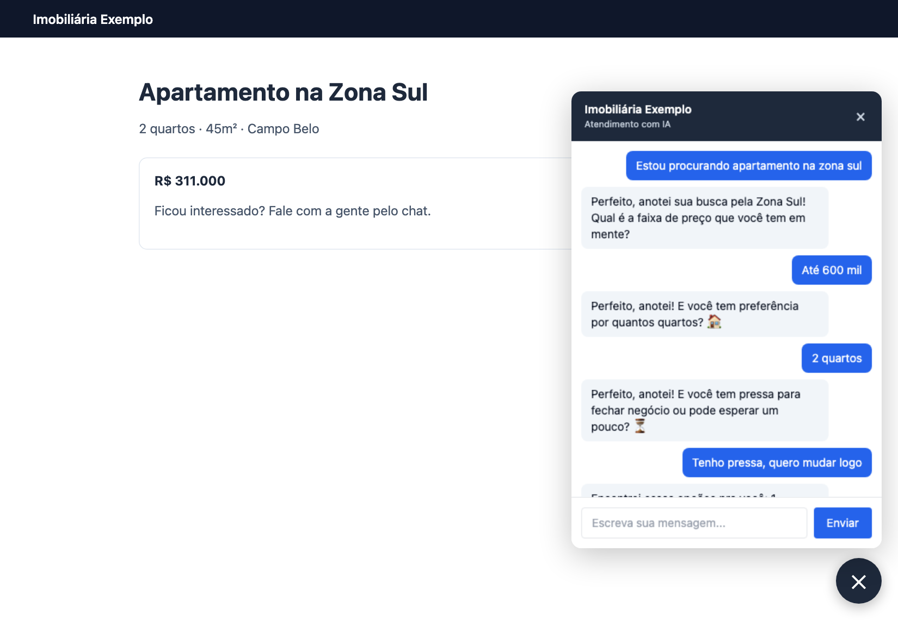
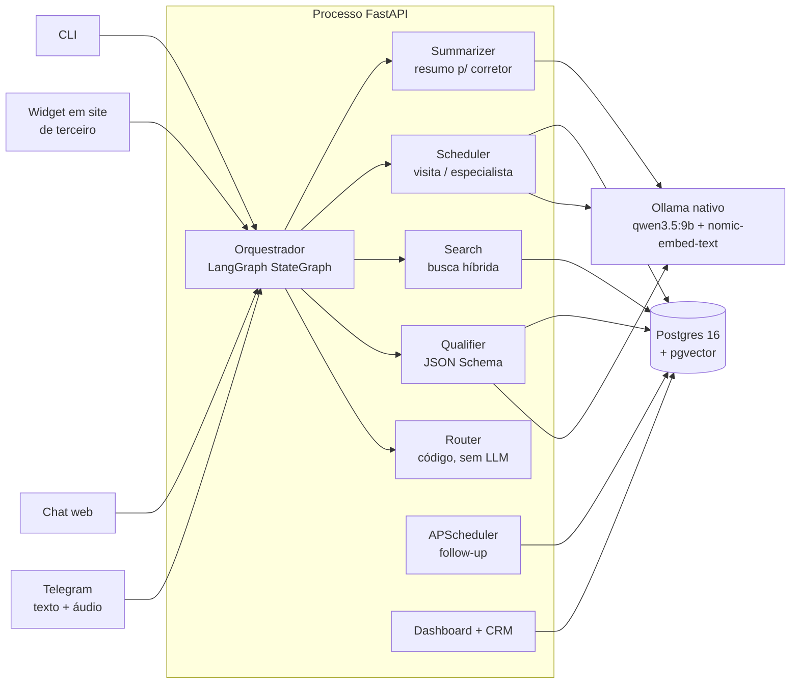

# Agente SDR Imobiliário — Bia

POC de um agente de IA generativa que atende, qualifica e agenda visitas com leads de uma imobiliária. Projeto do **Hackathon FIAP — Tech Challenge Fase 5**.

## Integrantes do grupo 10

Os membros do grupo são compostos pelos seguintes alunos:

- Wellson Almeida dos Santos (rm369201) — <wellson.digital@gmail.com>
- Nelson Seiji Takahashi (rm370089) — <seiji8503@gmail.com>

Youtube:  https://www.youtube.com/watch?v=E5UAWlIyjjk

## Testar agora (versão no ar)

Tudo abaixo está rodando, não precisa instalar nada:

| O quê | Onde | Acesso |
|---|---|---|
| 🤖 **Bot no Telegram** (texto e áudio) | [@ImobVendas_bot](https://t.me/ImobVendas_bot) | é só mandar "Oi" |
| 📊 **Painel do corretor** | <http://168.0.198.45:8000> | usuário `admin@teste.com.br` · senha `1234567890` |
| 🏠 **Site da imobiliária** (com a Bia no widget) | <http://168.0.198.45:5500> | aberto |

Roteiro sugerido: abra o painel numa aba e converse com o bot no Telegram. O lead aparece no painel em tempo real, com score, funil, conversa e traces de cada turno.

- **Compra ou aluguel:** "Quero alugar um apartamento de 2 quartos em Barueri até 5 mil". A Bia mostra os imóveis com fotos e agenda a visita com um corretor.
- **Investimento:** "Quero investir, busco renda com aluguel, uns 2 milhões". A Bia mostra os imóveis com rentabilidade estimada e agenda a conversa com o especialista em investimentos.
- **Voz:** mande um áudio no Telegram. A Bia transcreve e responde em áudio.


A Bia atende por Telegram (texto e áudio), chat web, widget embutido no site da imobiliária ou CLI. Os quatro canais passam pelo mesmo orquestrador. Ela entende se o lead quer comprar, alugar ou investir, qualifica com uma pergunta por mensagem, mostra imóveis reais do banco, agenda a visita com o corretor certo e volta a procurar quem some no meio da conversa. O corretor acompanha tudo num painel com score explicado, resumo e observabilidade.

> **Estado da entrega:** funcional e [publicada num servidor remoto](#testar-agora-versão-no-ar), acessível pela internet; também roda local com Docker Compose e Ollama nativo. **371 testes passando** com toda a infraestrutura no ar. O modelo é local (`qwen3.5:9b`, por Metal). Não há integração com WhatsApp (ver [Limitações](#limitações-conhecidas)). Para avaliar em Windows ou Linux, use o [modo demonstração](#rodar-em-1-minuto-em-qualquer-máquina-modo-demonstração).

📄 **Documento técnico em PDF:** [docs/DOCUMENTO_TECNICO.pdf](docs/DOCUMENTO_TECNICO.pdf) — arquitetura, IA utilizada, decisões e evidências num só arquivo.

## Sumário

- [Integrantes do grupo 10](#integrantes-do-grupo-10)
- [Testar agora (versão no ar)](#testar-agora-versão-no-ar)
- [Entregáveis do desafio](#entregáveis-do-desafio)
- [Requisitos do enunciado, um a um](#requisitos-do-enunciado-um-a-um)
- [O problema e a solução](#o-problema-e-a-solução)
- [Em imagens](#em-imagens)
- [Rodar em 1 minuto (modo demonstração)](#rodar-em-1-minuto-em-qualquer-máquina-modo-demonstração)
- [Como rodar a versão completa](#como-rodar-a-versão-completa)
- [Como usar](#como-usar)
- [Site da imobiliária com a Bia embutida](#site-da-imobiliária-com-a-bia-embutida)
- [Arquitetura](#arquitetura)
- [IA utilizada](#ia-utilizada)
- [Escalabilidade](#escalabilidade)
- [Segurança](#segurança)
- [Testes](#testes)
- [Limitações conhecidas](#limitações-conhecidas)

---

## Entregáveis do desafio

| Entregável pedido | Onde está |
|---|---|
| Repositório do projeto | este repositório |
| README | este arquivo |
| Arquitetura da solução | [ARQUITETURA.md](ARQUITETURA.md) (camadas, grafo do LangGraph, modelo de dados, trade-offs) · [docs/SOLID.md](docs/SOLID.md) · resumo [abaixo](#arquitetura) |
| Demonstração funcional | [modo demonstração](#rodar-em-1-minuto-em-qualquer-máquina-modo-demonstração) (qualquer máquina) · [versão completa](#como-rodar-a-versão-completa) · roteiro do vídeo em [pitchvideo.md](pitchvideo.md) |
| Pitch técnico | [PITCH.md](PITCH.md) |
| Explicação da IA utilizada | [IA.md](IA.md) · resumo [abaixo](#ia-utilizada) |
| Documento técnico consolidado | [docs/DOCUMENTO_TECNICO.pdf](docs/DOCUMENTO_TECNICO.pdf) |
| Rastreabilidade requisito → código → teste | [docs/VALIDACAO_REQUISITOS.md](docs/VALIDACAO_REQUISITOS.md) |
| Instalação detalhada | [INSTALL.md](INSTALL.md) |
| Enunciado original | [docs/ENUNCIADO.md](docs/ENUNCIADO.md) |

## Requisitos do enunciado, um a um

Legenda: ✅ feito · ⚠️ parcial · ❌ não feito. A versão com o teste que comprova cada linha está em [docs/VALIDACAO_REQUISITOS.md](docs/VALIDACAO_REQUISITOS.md).

### Objetivo do desafio

| Capacidade pedida | | Como foi feito |
|---|---|---|
| Atender leads automaticamente | ✅ | 4 canais (Telegram, chat web, widget, CLI) chamando o mesmo orquestrador, [`core/turno.py`](app/core/turno.py) |
| Realizar conversa humanizada | ✅ | Persona fixa ([`core/prompts.py`](app/core/prompts.py)), uma pergunta por mensagem, reconhece o que o cliente disse antes de perguntar, trata objeções, despedida e aceite curto |
| Qualificar clientes | ✅ | Extração de slots via JSON Schema ([`agents/qualifier.py`](app/agents/qualifier.py)) e score 0–100 determinístico e explicável ([`core/scoring.py`](app/core/scoring.py)) |
| Identificar intenção de compra, aluguel ou investimento | ✅ | Campo `intencao` no schema + regras por padrão de frase; testado com as frases literais do enunciado |
| Coletar informações relevantes | ✅ | 9 slots: intenção, região, quartos, preço mín./máx., urgência, perfil de investidor, ticket, expectativa de retorno |
| Realizar follow-up automático | ✅ | [`core/followup.py`](app/core/followup.py) + APScheduler: 3 tentativas (30 min, 2 h, 24 h) com o contexto da conversa |
| Agendar reuniões ou visitas | ✅ | Escolha do imóvel → horário → nome → telefone → confirmação com corretor; entende "sábado de manhã", "dia 8 às 13h"; permite reagendar |
| Integrar com uma base de imóveis | ✅ | 266 anúncios reais (294 registros venda/aluguel, 13 cidades, 731 fotos) em Postgres 16 + pgvector, com busca híbrida |
| Gerar resumos para corretores | ✅ | [`agents/summarizer.py`](app/agents/summarizer.py), em thread de fundo, exibido no detalhe do lead |

### Cenários esperados

| Cenário | | Comportamento |
|---|---|---|
| **1 — Compra:** *"Estou procurando apartamento na zona sul."* | ✅ | Entende a intenção → pergunta faixa de preço → quartos → região (se faltar) → urgência → apresenta imóveis → agenda a visita |
| **2 — Investimento:** *"Quero investir em imóveis para renda."* | ✅ | Perfil investidor → ticket → expectativa de retorno → encaminha para especialista (`status=encaminhado`) |
| **3 — Follow-up:** cliente iniciou e não respondeu | ✅ | Retoma sozinho, cita o que o cliente já disse e onde a conversa parou; quem pede para parar não recebe mais |

### Requisitos funcionais

| Requisito | | Onde |
|---|---|---|
| Atendimento conversacional | ✅ | 4 canais, um orquestrador |
| Conversa natural | ✅ | `temperature=0.15` + guardrails de saída ([IA.md](IA.md#temperatura-e-humanização)) |
| Fluxo humanizado | ✅ | Objeções, despedida e anti-repetição ([seção abaixo](#o-agente-nunca-repete-a-mesma-pergunta)) |
| Continuidade da conversa | ✅ | Memória rolante ([`core/memory.py`](app/core/memory.py)) + estado do lead no Postgres; quem volta retoma de onde parou |
| Qualificação de leads | ✅ | 9 slots + score explicável |
| Agendamento de reuniões | ✅ | Tabelas `visitas` e `encaminhamentos` |
| Resumo inteligente | ✅ | Card do corretor no detalhe do lead |
| Dashboard mínimo de acompanhamento | ✅ | `/dashboard`: leads por score, funil Kanban, indicadores, detalhe e observabilidade |

### Diferenciais (8 de 9)

| Diferencial | | Como |
|---|---|---|
| Uso de RAG | ✅ | Busca híbrida: filtro SQL estruturado + `0.6 × similaridade vetorial (pgvector) + 0.4 × ts_rank (full-text)` |
| Integração com WhatsApp | ❌ | Não feito. O Telegram usa o mesmo padrão de canal; trocar é escrever um adapter, não mexer no agente |
| Memória conversacional | ✅ | Resumo rolante + últimos 6 turnos literais; contexto abaixo de 8K tokens em qualquer duração |
| Multiagentes | ✅ | 5 agentes lógicos (router, qualifier, search, scheduler, summarizer) num `StateGraph` do LangGraph |
| Voice AI | ✅ | Entrada: áudio transcrito com `mlx-whisper` local. Saída: resposta em áudio com `say` (macOS) ou `piper` (Linux/container) |
| Integração com CRM | ✅ | `POST /crm/leads` (entrada) e `GET /crm/leads.csv` (exportação) |
| Observabilidade | ✅ | `agent_traces`: latência, tokens e tokens/s medidos por chamada; painel com p50/p95, quebra por agente e custo |
| Segurança | ✅ | Login argon2id + convite, sessão server-side, PII mascarada, rate limit, detecção de prompt injection |
| Deploy em cloud | ✅ | Versão publicada em servidor remoto, acessível pela internet: bot, painel e site ([Testar agora](#testar-agora-versão-no-ar)). Dockerfile e Compose prontos para replicar |

---

## O problema e a solução

Imobiliária perde lead pelos cinco motivos que o enunciado lista. Cada um tem uma resposta implementada:

| Dor | Resposta | Evidência |
|---|---|---|
| Tempo de resposta elevado | Atendimento automático 24h, em segundos | latência real em `agent_traces` |
| Falta de acompanhamento | Follow-up automático em 3 tentativas | `follow_up_jobs`; indicador "recuperados" |
| Atendimento manual | Qualificação inteira sem corretor | slots preenchidos no painel |
| Dificuldade em priorizar leads quentes | Score explicável, selo quente/morno/frio, funil Kanban | conta aberta no detalhe do lead |
| Sobrecarga dos corretores | Corretor entra com resumo pronto e visita marcada | card de resumo + `visitas` |

O que diferencia a solução:

- **Roda inteira na máquina da imobiliária.** Modelo e banco locais: nenhum dado do lead sai da máquina e o custo de inferência é zero. O painel mostra `US$ 0,00` ao lado do que a mesma conversa custaria numa API paga.
- **Fato crítico nunca é escrito pelo LLM.** Preço, endereço, data e corretor são montados em código a partir do banco. [`test_adversarial.py`](tests/test_adversarial.py) tenta fazer o agente mentir e verifica que ele não mente.
- **Fluxo decidido em código, texto decidido pelo LLM.** O roteador não chama o modelo: devolve um rótulo, e só depois o LLM escreve a frase daquele rótulo.
- **Score explicável.** O painel abre a conta em vez de mostrar só o número, e diz o que falta perguntar.
- **Imóveis reais.** Catálogo de uma imobiliária parceira, importado com autorização a partir do dado estruturado (`schema.org`) do próprio site dela.

## Em imagens

<!-- Capturas da aplicação real. O que cada uma mostra, e que mudança obriga a
     refazê-la, está em docs/imagens/README.md; scripts/screenshots/ refaz todas
     com o mesmo enquadramento. -->

| Painel do corretor: indicadores, funil e leads em tempo real | Detalhe do lead, com o score aberto |
|---|---|
|  |  |
| **Site da imobiliária** ([168.0.198.45:5500](http://168.0.198.45:5500)) | **A Bia embutida no site, atendendo** |
|  |  |
| **Observabilidade: custo, p95 e injeções** | **Chat do lead, com galeria de imóveis** |
|  |  |

Mais telas: [tentativa de prompt injection, marcada e classificada](docs/imagens/injection.png).

---

## Rodar em 1 minuto, em qualquer máquina (modo demonstração)

O projeto usa um modelo de 9B local, por Metal. Isso exigiria de quem avalia um Mac com Apple Silicon e 9 GB de modelo em disco. O modo demonstração troca o Ollama por um provedor de regras ([`app/core/llm_demo.py`](app/core/llm_demo.py)) e roda o fluxo inteiro (qualificação, busca no banco, agendamento, follow-up, resumo) em Windows, Linux ou Mac sem GPU:

```bash
uv venv --python 3.12 && source .venv/bin/activate && uv pip install -e .
docker compose up -d && python -m scripts.preparar_banco
LLM_DEMO=true python -m app.channels.cli
```

```
> Estou procurando apartamento na zona sul
< Perfeito, anotei. Qual faixa de preço você tem em mente?
> Até 600 mil
< Ótimo. De quantos quartos você precisa?
> 2 quartos
< Entendi. Você tem pressa pra fechar, ou pode esperar um pouco?
> Tenho pressa, quero mudar logo
< Encontrei essas opções pra você: ...
> Quero o 1 … Sábado de manhã … Meu nome é Ana, telefone 11 98888-7777
< Show, Ana! Marquei sua visita ... com o corretor ..., para sábado de manhã.
```

Imóveis, corretor, data e preço vêm do Postgres; só o **texto** sai de regra em vez de modelo. As respostas são piores que as do Ollama, e é esse o ponto: o modo demonstra **fluxo**, não qualidade de redação. Em `agent_traces` o modelo aparece como `demo-rules`, sem contagem de tokens, para o painel nunca mostrar número inventado.

## Como rodar a versão completa

Pré-requisitos: macOS com Apple Silicon (Metal para o Ollama e o Whisper), Docker, Python 3.12, [`uv`](https://github.com/astral-sh/uv) e [Ollama](https://ollama.com) instalado nativamente (**nunca em container**: sem Metal, a inferência cai para velocidade de CPU). Passo a passo por tipo de máquina e problemas comuns em [INSTALL.md](INSTALL.md).

```bash
# 1. modelos
ollama pull qwen3.5:9b
ollama pull nomic-embed-text
ollama serve &

# 2. banco (Postgres 16 + pgvector)
docker compose up -d

# 3. dependências
uv venv --python 3.12 && source .venv/bin/activate
uv pip install -e .

# 4. configuração
cp .env.example .env
# TELEGRAM_BOT_TOKEN: token do BotFather (vazio = Telegram desligado; chat web e CLI seguem funcionando)

# 5. schema + catálogo de imóveis (idempotente)
python -m scripts.preparar_banco

# 6. tudo num processo: Telegram + dashboard + chat web + CRM + follow-up
uvicorn app.web.api:app --host 0.0.0.0 --port 8000
```

| Endereço | O quê |
|---|---|
| `http://localhost:8000/dashboard` | painel do corretor (o primeiro acesso cria o administrador em `/registro`) |
| `http://localhost:8000/chat` | chat web do lead |
| `http://localhost:5500` | site da imobiliária com a Bia embutida (sobe junto com `./run.sh`; ver [abaixo](#site-da-imobiliária-com-a-bia-embutida)) |
| `python -m app.channels.cli` | conversa pelo terminal, sem Telegram |

### App em container (alternativa)

```bash
docker compose --profile app up -d --build
```

Sobe Postgres e app juntos; schema e catálogo são carregados no entrypoint. O Ollama continua nativo no host (o container chega nele por `host.docker.internal:11434`) e a transcrição de áudio fica desligada no container, porque `mlx-whisper` só existe para Apple Silicon. A resposta em áudio funciona no container via `piper`.

> ⚠️ **Um bot, uma instância.** O Telegram aceita um único `getUpdates` por token: `./run.sh` e o container ao mesmo tempo geram `Conflict: terminated by other getUpdates request`. Escolha um.

### Voz (opcional)

```bash
uv pip install -e ".[stt]"
# no .env
STT_ENABLED=true     # transcreve o áudio do cliente (Apple Silicon)
TTS_ENABLED=true     # responde em áudio
```

A Bia responde em áudio **a quem mandou áudio** (`TTS_SEMPRE=true` força sempre). O texto vai junto: voz complementa, não substitui. Se o download do modelo Whisper travar, use `scripts/baixar_modelo_stt.sh` e aponte `STT_MODEL_PATH` para o diretório baixado.

## Como usar

**Telegram, chat web ou CLI.** Conversa normal, em texto ou áudio. *"Estou procurando apartamento na zona sul"* leva ao fluxo de compra; *"Quero investir em imóveis para renda"* leva ao fluxo de investimento, que termina em encaminhamento a um especialista. O cliente pode escolher imóvel pelo número do card ou pelo código do anúncio.

**Dashboard** (`/dashboard`). Leads ordenados por score com selo quente/morno/frio, funil Kanban, indicadores (1ª resposta, recuperados por follow-up) e, no detalhe de cada lead, slots, resumo para o corretor, histórico e score explicado:

```
86  quente  de 100
Dados coletados   40/40   4 de 4 campos de qualificação preenchidos.
Urgência          30/30   Urgência alta.
Ticket             6/20   Ticket de R$ 600.000 (teto de referência: R$ 2.000.000).
Visita agendada   10/10   Visita confirmada.
```

O total é a soma das parcelas, e um teste garante isso. Sem orçamento informado, a prioridade não passa de morno.

**Observabilidade** (`/dashboard/traces`). Latência p50/p95/pior, tokens/s, taxa de erro, quebra por agente, tentativas de prompt injection e o custo real (US$ 0,00) ao lado do contrafactual "se fosse nuvem", calculado sobre os tokens medidos.

**CRM.** `POST /crm/leads` recebe lead de fora; `GET /crm/leads.csv` exporta a base.

**Widget.** A Bia entra no site de qualquer imobiliária com uma linha:

```html
<script src="http://localhost:8000/widget.js" data-brand="Imobiliária Exemplo" defer></script>
```

CSS isolado em Shadow DOM, iframe carregado só no primeiro clique, sessão no `localStorage` (cookie de terceiro seria bloqueado no Safari/Firefox). Quem pode embutir é controlado por `WIDGET_DOMINIOS`, que vira `frame-ancestors` no CSP.

## Site da imobiliária com a Bia embutida

Para mostrar a Bia onde ela viveria de verdade, o projeto gera o site de uma imobiliária fictícia, a **Horizonte Imóveis**, com o widget já instalado. Detalhes em [site/README.md](site/README.md).

- **O que tem:** página inicial (busca, destaques de venda e locação, bairros, institucional), listagens de **comprar** e **alugar** com filtro por bairro, e uma página de detalhe para cada imóvel do catálogo, com fotos do anúncio, preço, metragem, condomínio e IPTU.
- **De onde vêm os dados:** gerado a partir do Postgres por [`site/build.py`](site/build.py). Preço, endereço, metragem e código saem do banco, nunca de template: o mesmo guardrail do card do agente vale para a vitrine.
- **Integração com a Bia:** os botões do site abrem o chat com a mensagem pronta. *Tenho interesse* envia "Quero ver o `<código>`"; *Agendar visita* envia "Quero agendar uma visita ao `<código>`"; *Tirar dúvidas* envia "Tenho dúvidas sobre o `<código>`". A Bia já sabe de qual imóvel se trata, porque o código é o mesmo do anúncio. A busca por código leva direto à página do imóvel.
- **Tecnologia:** HTML estático e uma folha de estilo, sem build de JavaScript. O único script é o `widget.js` do projeto.

```bash
python site/build.py                              # gera site/dist/ a partir do banco
python -m http.server 5500 --directory site/dist  # abre em http://localhost:5500
python site/build.py --app https://seu-app.exemplo.com   # para publicar apontando para outro servidor
```

O chat do site só responde com a aplicação rodando na porta 8000, de onde vem o `widget.js`. Sem ela, o site abre normalmente e só a bolha fica sem resposta. O `./run.sh` gera e serve o site automaticamente.

---

## Arquitetura

Um processo FastAPI hospeda o Telegram (long polling), o chat web, o widget, o dashboard, o CRM e o scheduler de follow-up. Todos os canais chamam o mesmo orquestrador, um `StateGraph` do LangGraph ([`core/graph.py`](app/core/graph.py)), que aciona cinco agentes lógicos. Os agentes são funções, não processos, e usam o mesmo modelo Ollama já carregado em memória.



**Fluxo de um turno:** o canal recebe a mensagem (áudio vira texto antes) → o grafo escolhe o ramo pelo status do lead (qualificação, escolha de visita, pós-desfecho) → uma chamada de **extração** (JSON Schema) atualiza os slots → o roteador decide o próximo passo em código → uma chamada de **resposta** escreve a frase → fatos do banco são anexados em código → o nó `finalizar` atualiza memória, resumo e follow-up.

```
app/
  agents/   router.py  qualifier.py  search.py  scheduler_agent.py  summarizer.py
  core/     graph.py  turno.py  llm.py  llm_demo.py  prompts.py  memory.py  followup.py
            scoring.py  security.py  auth.py  injecao.py  traces.py  custo.py  stt.py  tts.py  config.py
  channels/ telegram.py  cli.py
  web/      api.py  templates/  static/   (dashboard, chat, widget e CRM; HTMX, sem build)
  db/       schema.sql  repo.py  seed.py  catalogo_orion.json
scripts/    preparar_banco.py  importar_orion.py  carregar_catalogo.py  buscar.py  ...
tests/      suíte de unidade e de integração real (Postgres + Ollama)
```

Detalhes (grafo completo gerado do código, modelo de dados, índices, trade-offs): [ARQUITETURA.md](ARQUITETURA.md). Princípios SOLID mapeados a arquivo e função: [docs/SOLID.md](docs/SOLID.md).

**Stack:** Python 3.12 · FastAPI + Jinja2 + HTMX · LangGraph · Ollama (`qwen3.5:9b`, `nomic-embed-text`) · Postgres 16 + pgvector · APScheduler · `python-telegram-bot` · `mlx-whisper` · `say`/`piper` · Docker Compose.

### O agente nunca repete a mesma pergunta

Cliente que não responde o que foi perguntado não muda slot nenhum, e um roteador puro repetiria a mesma frase para sempre. Medido por uma sonda com respostas inúteis ("sim", "sei lá"): acontecia em 6 de 6 cenários. Hoje `leads.acao_repeticoes` conta decisões iguais seguidas e, na 3ª, o campo é dispensado e a conversa muda de rota: mostra onde há imóvel, mostra a faixa real de preços, afrouxa o filtro dizendo o que afrouxou ou passa para um humano. Resultado: 0 de 6, travado em [`tests/test_sem_loop.py`](tests/test_sem_loop.py).

### Código do imóvel e fotos

Cada imóvel tem código público e estável (o mesmo do anúncio da imobiliária). O cliente pode agendar citando o código, que vale mesmo depois de outra busca, ao contrário do número posicional do card. As fotos são versionadas no repositório e servidas pela própria aplicação: a dependência anterior de um banco de imagens externo quebrou a galeria em produção quando o serviço passou a responder 401.

## IA utilizada

| Uso | Modelo | Onde roda |
|---|---|---|
| Extração de slots e respostas | `qwen3.5:9b` (Q4_K_M) | Ollama nativo, Metal |
| Embeddings da busca | `nomic-embed-text` (768 dims) | Ollama nativo |
| Transcrição de áudio | `whisper-small` via `mlx-whisper` | local, Metal |
| Resposta em áudio | `say` (macOS) / `piper` `pt_BR-faber-medium` | local |

Decisões principais (detalhadas, com os números medidos, em [IA.md](IA.md)):

- **Saída estruturada, não tool calling livre.** Um modelo de 9B não sustenta um loop ReAct confiável. A extração usa o `format` do Ollama com JSON Schema gerado do Pydantic. Cada turno faz duas chamadas separadas: extração e resposta.
- **Guardrails estruturais.** Prompt reduz alucinação, mas não zera. Por isso preço, endereço, data e corretor são montados em código; datas são resolvidas com `datetime`, não pelo modelo; frases com número são descartadas; o resumo é descartado se citar valor que não está nos slots.
- **RAG híbrido.** Filtro SQL primeiro (preço, quartos, tipo, bairro), ranking semântico + full-text depois. Evita a falha clássica do RAG puro: imóvel parecido, mas fora do orçamento.
- **Memória rolante.** Últimos 6 turnos literais + resumo do restante, regerado periodicamente.
- **Score determinístico.** `40 × completude + 30 × urgência + 20 × ticket + 10 × visita`. Número estável e auditável vale mais que um número "inteligente" que varia entre duas chamadas.
- **`temperature=0.15`.** A 0.4, o modelo inventava "Zona Sul" em 2 de 5 respostas.

## Escalabilidade

- **Aplicação stateless:** todo estado está no Postgres; N réplicas atrás de um balanceador sem mudar código.
- **LLM atrás de HTTP:** trocar `OLLAMA_HOST` por um cluster com GPU é variável de ambiente.
- **Gargalo medido:** `agent_traces` grava latência e tokens/s reais de cada chamada.
- **Follow-up:** é o único componente single-node (APScheduler in-process); `follow_up_jobs` já é tabela e vira fila distribuída com `SELECT ... FOR UPDATE SKIP LOCKED`.
- **Busca vetorial:** scan sequencial é o certo para centenas de imóveis; índice HNSW entra a partir de ~10 mil, sem mudar a query.

## Segurança

- **Painel fechado:** login com senha em hash **argon2id**, sessão server-side (só o SHA-256 do token no banco), cookie `HttpOnly` + `SameSite=Lax`. O primeiro cadastro vira administrador e o registro aberto fecha; os demais entram por convite de uso único com prazo.
- **PII:** telefone do lead persiste mascarado (DDD + 4 últimos dígitos).
- **Prompt injection:** o texto do lead nunca entra no system prompt; tentativas são detectadas por padrão de frase em 4 tipos e **marcadas** no painel (não bloqueadas, para não recusar cliente real por falso positivo).
- **Segredos:** o token do bot é suprimido dos logs do `httpx`.
- **Abuso:** rate limit por `chat_id`.
- **LGPD:** o dado do lead não sai da máquina, porque modelo e banco são locais.

## Testes

```bash
uv pip install -e ".[dev]"
pytest
```

Boa parte da suíte é de integração real, contra o Postgres e o Ollama, sem mock: os bugs que mais custaram neste projeto foram de formato de schema, e um mock os esconderia. Sem a infraestrutura, esses testes **pulam** com o motivo e o comando na mensagem, em vez de falhar ([tests/conftest.py](tests/conftest.py)).

```
sem o Postgres no ar      →  273 passed, 98 skipped em 9 s
tudo no ar                →  371 passed em ~15 min
```

Destaques: [`test_adversarial.py`](tests/test_adversarial.py) (o agente não mente sobre preço nem concede desconto), [`test_sem_loop.py`](tests/test_sem_loop.py) (sem repetição infinita), [`test_injecao.py`](tests/test_injecao.py) (incluindo falsos positivos), [`test_qualifier.py`](tests/test_qualifier.py) (frases literais do enunciado).

## Limitações conhecidas

- **Sem integração com WhatsApp.** A aprovação de número comercial não cabia no prazo; o Telegram segue o mesmo padrão de canal.
- **Deploy em servidor único.** A versão no ar roda numa máquina só; escalar horizontalmente exige balanceador e fila distribuída para o follow-up (ver [Escalabilidade](#escalabilidade)).
- **Transcrição de áudio só em Apple Silicon** (`mlx-whisper`). A resposta em áudio funciona em macOS e Linux.
- **Follow-up in-process** (APScheduler), não fila distribuída.
- **Sem índice vetorial**, escolha deliberada para o tamanho atual do catálogo.
- `DEMO_MODE=true` encurta os intervalos de follow-up (30 min/2 h/24 h → 90 s/180 s/300 s) para a demonstração acontecer ao vivo; em produção, `DEMO_MODE=false`.

## Licença

[LICENSE](LICENSE)
